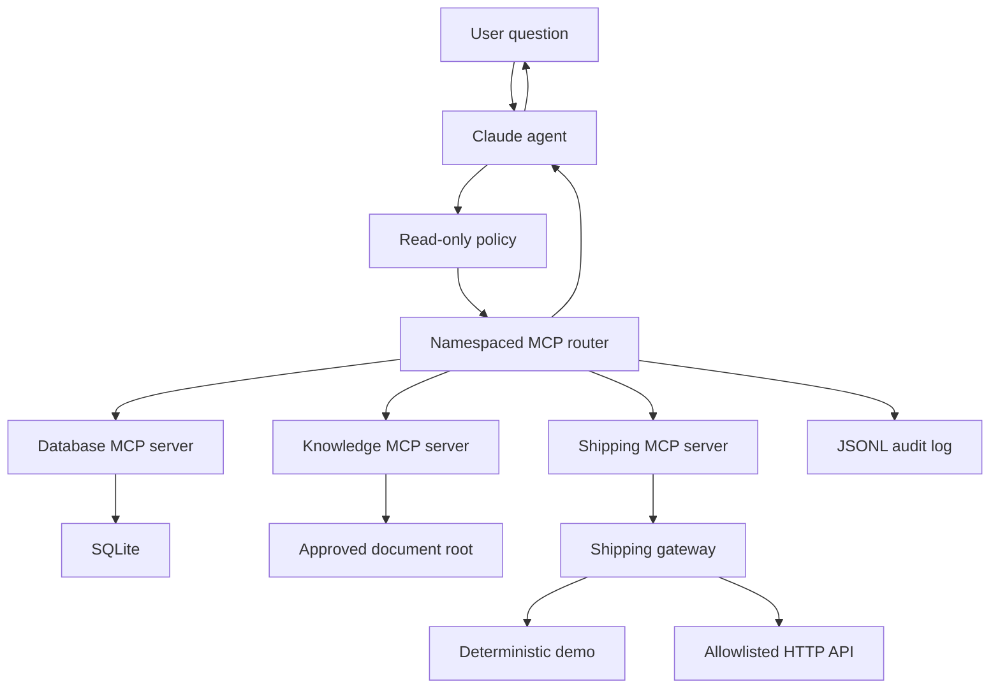

# MCP Operations Agent

A guarded Claude agent that discovers and uses tools from
multiple Model Context Protocol (MCP) servers.

The project demonstrates how an AI agent can safely combine:

- Structured operations data from SQLite
- Policy documents from a contained filesystem
- Shipment data from a demo or HTTP API
- Claude tool selection and response synthesis
- Read-only tool governance
- Structured validation and audit logging
- Timeouts, output bounds, and partial-failure handling

## Example

```powershell
uv run python -m mcp_operations_agent.main `
    --question "Find all processing orders. For each order, retrieve its shipment and latest delivery event. Report the customer, order total using its supplied currency, carrier, tracking number, shipment status, and latest event."
```

Example result:

```text
Customer: Acme Estates
Order: 101
Total: 12,500.00 ZAR
Carrier: Ubuntu Express
Tracking number: ZA-ACME-101
Shipment status: in_transit
Latest event: Shipment departed the Johannesburg facility
```

## Architecture



Claude never receives direct database, filesystem, or arbitrary
HTTP access. It can only call tools discovered from the configured
MCP servers.

## MCP Servers

### Operations Database

Provides read-only access to customers and orders.

Tools:

- `list_customers`
- `get_customer`
- `find_orders`

The agent exposes these as:

- `database__list_customers`
- `database__get_customer`
- `database__find_orders`

The SQLite repository uses parameterized queries, bounded result
counts, validated filters, and deterministic development data.

### Operations Knowledge Base

Provides contained access to approved UTF-8 documents.

Tools:

- `list_documents`
- `read_document`
- `search_documents`

The agent exposes these as:

- `knowledge__list_documents`
- `knowledge__read_document`
- `knowledge__search_documents`

Filesystem controls include:

- Configured root directory
- Absolute-path rejection
- Path-traversal protection
- Symlink-escape protection
- Extension allowlisting
- Maximum file-size enforcement
- Bounded search results

### Operations Shipping API

Provides shipment and delivery-event information.

Tools:

- `get_shipment`
- `get_delivery_events`

The agent exposes these as:

- `shipping__get_shipment`
- `shipping__get_delivery_events`

Two gateway implementations are available:

- `DemoShippingGateway` for deterministic, free local development
- `HttpShippingGateway` for an authenticated external HTTP service

The HTTP adapter provides fixed endpoint construction, response
validation, timeouts, bounded retries, safe error mapping, and API
key isolation.

## Why Tool Names Are Namespaced

Different MCP servers may expose tools with identical names.

The router publishes names such as:

```text
database__find_orders
knowledge__search_documents
shipping__get_shipment
```

It then maps each call back to the correct connected server. This
avoids collisions and makes audit records easier to interpret.

## Safety Model

The application treats model output as untrusted orchestration
input.

Safeguards include:

- Only explicitly read-only MCP tools are accepted
- Tool names must come from live MCP discovery
- Invented tool names are rejected
- Pydantic validates tool arguments and returned data
- Agent tool-use rounds are bounded
- Individual tool calls have timeouts
- Oversized tool results are truncated
- Internal exceptions are converted into safe tool errors
- Partial answers must identify unverified information
- Audit logs exclude tool-result payloads
- Sensitive argument names are redacted
- Local data, logs, and environment files are Git-ignored

MCP tool annotations are treated as policy metadata, not as a
complete security boundary. Enforcement also occurs in the
repository, document store, HTTP adapter, router, and agent loop.

## Audit Logging

Every attempted agent tool call records:

- UTC timestamp
- Namespaced tool name
- Claude tool-use ID
- Sanitized arguments
- Success or failure
- Duration in milliseconds
- Safe error information

Example:

```json
{
  "timestamp": "2026-10-26T19:27:00Z",
  "event_type": "mcp_tool_call",
  "tool_name": "shipping__get_shipment",
  "tool_use_id": "toolu_example",
  "arguments": {
    "order_id": 101
  },
  "success": true,
  "duration_ms": 4,
  "error": null
}
```

Audit logs are written to `run_logs/` and are excluded from Git.

## Technology Stack

- Python 3.12
- MCP Python SDK
- Anthropic Claude
- Pydantic v2
- Pydantic Settings
- HTTPX
- SQLite
- pytest
- uv

## Installation

Clone the repository:

```powershell
git clone https://github.com/Melusi-M/mcp-operations-agent.git
cd mcp-operations-agent
```

Install the locked dependencies:

```powershell
uv sync
```

Create the local environment file:

```powershell
Copy-Item .env.example .env
```

Set a valid Anthropic API key in `.env`:

```dotenv
ANTHROPIC_API_KEY=replace-with-your-api-key
```

Never commit `.env`.

## Configuration

```dotenv
ANTHROPIC_API_KEY=replace-with-your-api-key
MCP_OPERATIONS_MODEL=claude-haiku-4-5-20251001
MCP_OPERATIONS_MAX_TOKENS=1000
MCP_OPERATIONS_MAXIMUM_ROUNDS=5

MCP_OPERATIONS_AUDIT_LOG_PATH=run_logs/mcp_tool_audit.jsonl
MCP_OPERATIONS_TOOL_TIMEOUT_SECONDS=10
MCP_OPERATIONS_MAXIMUM_TOOL_RESULT_CHARS=20000

MCP_OPERATIONS_KNOWLEDGE_ROOT=knowledge_base
MCP_OPERATIONS_MAXIMUM_FILE_BYTES=100000

MCP_OPERATIONS_SHIPPING_MODE=demo
MCP_OPERATIONS_SHIPPING_API_BASE_URL=https://shipping.example.com
MCP_OPERATIONS_SHIPPING_API_KEY=replace-with-shipping-api-key
MCP_OPERATIONS_SHIPPING_TIMEOUT_SECONDS=5
MCP_OPERATIONS_SHIPPING_MAXIMUM_ATTEMPTS=2
```

Shipping API URL and key settings are only required when:

```dotenv
MCP_OPERATIONS_SHIPPING_MODE=http
```

The HTTP shipping service is expected to provide compatible
read-only endpoints:

```text
GET /shipments/orders/{order_id}
GET /shipments/{tracking_number}/events
```

## Running the Agent

Using the module:

```powershell
uv run python -m mcp_operations_agent.main `
    --question "Which customers have pending orders?"
```

Using the installed console command:

```powershell
uv run mcp-operations-agent `
    --question "Which customers have pending orders?"
```

## MCP Inspector

Inspect the database server:

```powershell
uv run mcp dev `
    .\src\mcp_operations_agent\servers\database_server.py
```

Inspect the knowledge server:

```powershell
uv run mcp dev `
    .\src\mcp_operations_agent\servers\filesystem_server.py
```

Inspect the shipping server:

```powershell
uv run mcp dev `
    .\src\mcp_operations_agent\servers\shipping_server.py
```

The shipping server uses deterministic demo data by default.

## Testing

Run the complete suite:

```powershell
uv run pytest -q
```

Current test coverage includes:

- SQLite schema and repository behavior
- Database MCP tool integration
- Filesystem containment
- Filesystem MCP tools
- Demo and HTTP shipping gateways
- Shipping MCP tools
- MCP pagination and result handling
- Multi-server namespaced routing
- Read-only policy enforcement
- Claude tool-use orchestration
- Tool auditing and redaction
- Timeout and internal-failure handling
- Tool-result size limits
- Environment configuration validation

At the current milestone:

```text
74 passed
```

## Project Structure

```text
src/mcp_operations_agent/
├── agent.py
├── audit.py
├── claude_gateway.py
├── config.py
├── database.py
├── document_store.py
├── main.py
├── mcp_client.py
├── models.py
├── shipping_api.py
├── tool_policy.py
├── tool_router.py
└── servers/
    ├── database_server.py
    ├── filesystem_server.py
    └── shipping_server.py
```

## Design Decisions

### Separate MCP Servers

Database, filesystem, and API capabilities run as separate MCP
servers. This provides explicit trust boundaries and allows each
integration to evolve or deploy independently.

### Read-Only First

The first release intentionally excludes mutation tools. Read-only
operations reduce the impact of incorrect model decisions and make
the control model easier to inspect.

### Deterministic Demo Mode

The demo shipping gateway and seeded SQLite database make the
project reproducible without paid third-party services.

### Structured Boundaries

Pydantic models validate application data, MCP tool arguments,
external API responses, and configuration before those values enter
the agent workflow.

### Dependency Injection

Repositories, gateways, MCP clients, Claude gateways, and audit
loggers can be replaced in tests. This allows the suite to run
without making live Claude or external API calls.

## Limitations

- SQLite is intended for local demonstration, not concurrent
  production workloads.
- The JSONL audit writer is process-local.
- HTTP shipping endpoints use a provider-neutral demonstration
  contract.
- Authentication and authorization are not user-specific.
- The CLI handles one question per process.
- No mutation tools or human approval workflow are included yet.
- No distributed tracing or centralized metrics backend is
  configured.

## Future Improvements

- Human approval for controlled write operations
- OAuth-based MCP server authentication
- Per-user authorization and tenant isolation
- OpenTelemetry traces and metrics
- PostgreSQL repository implementation
- Centralized audit storage
- Streaming responses
- Circuit breakers for external APIs
- Parallel execution of independent tool calls
- Containerized deployment
- Continuous integration and dependency scanning

## License

This project is available under the MIT License.